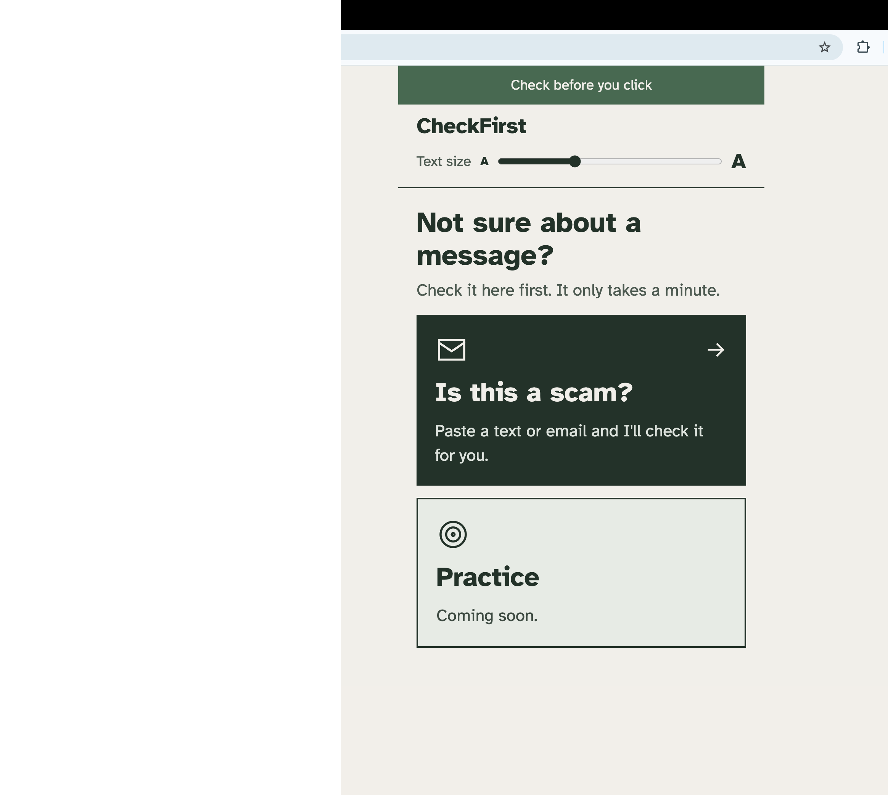

# Process log

CheckFirst: a phone-friendly web page that helps older adults check whether a message is a scam, and practice spotting scams.

## 2026-11-14 — Building something for my grandparents

**Stage:** Empathize, Define, Ideate

**What I did.** I started with ideas for an app or website for 5C students, but I wanted whatever I make in this class to be used by me, my mom, or my grandparents. I talked with my grandparents and my mom, who live back home, a 16-hour flight away. From that I came up with CheckFirst: a web page where anyone can copy and paste a text message or email and find out whether it's a scam, using the Google Safe Browsing API, plus a practice mode where people learn how to spot scams. Today I wrote CONTRACT.md, similar to Lab 7, with the rules for everything the website is supposed to do.

**What I learned.** Older people, my grandparents included, can be very tech savvy and still be unable to tell whether a message is a scam. They commonly get text messages, phone calls, and emails telling them to do something or open a website, and it creates a lot of fear in their minds. My grandfather is better at spotting scams, but my grandma, not so much.

**What changed because of it.** I dropped the 5C student ideas and decided to build something for my grandparents instead: a scam checker with a practice mode.

**Working with AI.** I made my CLAUDE.md file with the project's stack and rules. I was having some issues with the reflect skill, so I changed a couple of files to make it work.

**Evidence.** 28554f2 (CLAUDE.md, reflect skill), #1 (CONTRACT.md and .gitignore), #2 (reflect skill fix)

**Next.** Talk to people in the elderly community to really empathize with them and understand their problems. I want to find out whether other older people have the same issues, and what kinds of fears they have. One is safety: there are already a lot of apps that do what my web page is meant to do, but many of them make you give up access to your phone, call logs, message logs, and emails, which you really shouldn't do. I want to know how much older people think about that. I also want to figure out what would help them most and why: when they run into a possible scam, can they reach someone to ask, or not, and why would they need this web page? Then slowly move into prototyping: building the website, its design and layout, and the API parts.

## 2026-11-15 — Design feedback from Professor Dodds

**Stage:** Prototype, Test

**What I did.** I made a clickable mockup prototype of the website in a Claude.ai chat and showed it to Professor Dodds. He really liked the idea. I also cleaned up my CLAUDE.md.

**What I learned.** Professor Dodds pointed out that the recent checks take up a lot of space on the home page, and suggested making the check and practice sections larger and clearer. He also suggested that instead of the button, I use a slider that allows for larger text. He asked how practice mode is going to work, and whether it would work by feeding an LLM a dataset of example messages and emails and how to tell them apart.

**What changed because of it.** I'm going to make the design changes he suggested, and look into datasets I can use to train an LLM for practice mode.

**Working with AI.** I cleaned up CLAUDE.md: I fixed the wording, added "Follow CONTRACT.md for what the app does," and changed "Never edit anything in CONTRACT.md" to "Don't change CONTRACT.md unless I ask. Propose changes in a PR."

**Evidence.** d8e3b0e (CLAUDE.md update)

**Next.** Make the design changes, look into datasets for practice mode, and pivot to writing the code and building the website into an actual URL for design reviews.

## 2026-11-15 — From prototype to a live website

**Stage:** Prototype, Test, building

**What I did.** Tonight I went from prototype to a live website. First I deployed a hello-world FastAPI app to Railway (#5). My Railway trial had expired, so I had to choose between paying for Hobby or switching to something like Vercel. I stayed on Railway at $5 a month because it's the course stack and staff can help me debug it. Railway also couldn't load my branches until I gave its GitHub app access to the repo. Then I built the real scam check with the LLM (#6). Once it worked, I didn't like the UI: it felt bare and boring, didn't feel like a real website, and only worked as a phone layout. So I made a second design reference that works on laptop and phone, with a nav bar, a hero with a phone showing a scam text, how-it-works steps, and common scam types (#8). After deploying it, I checked the website on my phone and the nav buttons only showed up on the laptop version, so I added them for phones too (#9).

**What I learned.** The first time I tested the check live, it failed with "credit balance too low." From the Railway logs I figured out the code was calling Anthropic directly with my own account, but our Glassroom key speaks the OpenAI API. Railway's deployment logs were really useful for figuring out why things weren't working; the API key issues were only something I could figure out by looking at the logs. The good news is the error message showed exactly as designed every time it failed, instead of breaking the page. I also learned how effective my AI workflow is: building the prototype first on Claude.ai, then giving Claude Code reference HTML files to build from.

**What changed because of it.** I switched to the OpenAI SDK pointed at Glassroom with claude-haiku-4-5 (#7), then fixed one more error where the variable name in Railway didn't match. I revised my second design by cutting some things that made the website look too "AI generated," and added buttons to the nav bar for easy navigation. After testing on my phone, I made the nav buttons show on the phone layout too.

**Working with AI.** I prototyped the design on Claude.ai, saved it as a reference HTML file in docs/, and had Claude Code build the real page from it, first for the phone-only version and then for the laptop-and-phone version.

**Evidence.** #5 (hello-world deploy), #6 (scam check), #7 (switch to Glassroom), #8 (redesign from design-reference-v2.html), #9 (nav buttons on phones)

**Next.** Add the database and the last-check line, add Safe Browsing, and then test and ask others for feedback on how the website is looking.

## 2026-11-15 — Finishing the core of the app

**Stage:** building, Test

**What I did.** Tonight I finished the core of the app. I added Google Safe Browsing to the check (#11): it pulls the links out of a message, checks them against Google's list, and gives the result to the model. If a link is flagged, the result is always "Likely scam." Then I built practice mode (#12) with 12 example messages, 8 scams and 4 real ones. The answer stays on the server so it can't be seen in the browser. Then I added the database (#13): a device code saved on the phone, a table for checks with no message text saved (just the level, a short topic, and token counts), and a table for practice attempts. The home page now shows the last check, and practice shows an all-time score.

**What I learned.** Testing showed why I need both Safe Browsing and the LLM: my fake package link wasn't on Google's list, but the LLM still caught it from the wording. After merging the database, the Railway deploy crashed with "No module named psycopg." It worked on my laptop because locally the app uses SQLite, so it never needed a Postgres driver. Newer SQLAlchemy expects psycopg 3, not the older psycopg2 driver I had installed.

**What changed because of it.** I swapped the Postgres driver in requirements.txt from psycopg2-binary to psycopg 3 (#14), and the practice data and checks now survive a redeploy. I also changed how I think about practice mode since talking to Professor Dodds: instead of training an LLM on a dataset, the plan is to give the model a few of my examples as a pattern and have it write new messages aimed at the signs each person misses.

**Working with AI.** I added two lessons to CLAUDE.md under "Mistakes to avoid": the LLM goes through Glassroom with the OpenAI SDK, never the Anthropic SDK directly, and because the app uses SQLite locally, any database package change has to be checked with a Postgres URL before merging.

**Evidence.** #11 (Safe Browsing), #12 (practice mode), #13 (database), #14 (psycopg 3 driver fix), 1a8557c (CLAUDE.md mistakes to avoid)

**Next.** Test the live site with older adults (the paste test and practice mode), have the LLM write practice messages, and start the cost-benefit analysis using the token counts.
