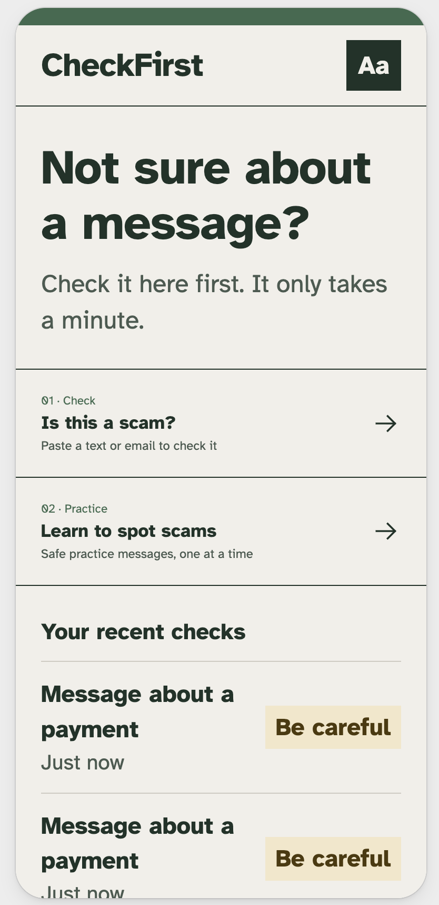

# Process log

CheckFirst: a phone-friendly web page that helps older adults check whether a message is a scam, and practice spotting scams.

## 2026-11-14 — Building something for my grandparents

**Stage:** Empathize, Define, Ideate

**What I did.** I started with ideas for an app or website for 5C students, but I wanted whatever I make in this class to be used by me, my mom, or my grandparents. I talked with my grandparents and my mom, who live back home, a 16-hour flight away. From that I came up with CheckFirst: a web page where anyone can copy and paste a text message or email and find out whether it's a scam, using the Google Safe Browsing API, plus a practice mode where people learn how to spot scams. Today I wrote CONTRACT.md, similar to Lab 7, with the rules for everything the website is supposed to do.

**What I learned.** Older people, my grandparents included, can be very tech savvy and still be unable to tell whether a message is a scam. They commonly get text messages, phone calls, and emails telling them to do something or open a website, and it creates a lot of fear in their minds. My grandfather is better at spotting scams, but my grandma, not so much.

**What changed because of it.** I dropped the 5C student ideas and decided to build something for my grandparents instead: a scam checker with a practice mode.

**Working with AI.** I made my CLAUDE.md file with the project's stack and rules. I was having some issues with the reflect skill, so I changed a couple of files to make it work.

**Evidence.** 28554f2 (CLAUDE.md, reflect skill), #1 (CONTRACT.md and .gitignore), #2 (reflect skill fix)

**Next.** Talk to people in the elderly community to really empathize with them and understand their problems. I want to find out whether other older people have the same issues, and what kinds of fears they have. One is safety: there are already a lot of apps that do what my web page is meant to do, but many of them make you give up access to your phone, call logs, message logs, and emails, which you really shouldn't do. I want to know how much older people think about that. I also want to figure out what would help them most and why: when they run into a possible scam, can they reach someone to ask, or not, and why would they need this web page? Then slowly move into prototyping: building the website, its design and layout, and the API parts.

## 2026-11-15 — Design feedback from Professor Dodds

**Stage:** Prototype, Test

**What I did.** I made a clickable mockup prototype of the website in a Claude.ai chat and showed it to Professor Dodds. He really liked the idea. I also cleaned up my CLAUDE.md.

**What I learned.** Professor Dodds pointed out that the recent checks take up a lot of space on the home page, and suggested making the check and practice sections larger and clearer. He also suggested that instead of the button, I use a slider that allows for larger text. He asked how practice mode is going to work, and whether it would work by feeding an LLM a dataset of example messages and emails and how to tell them apart.

**What changed because of it.** I'm going to make the design changes he suggested, and look into datasets I can use to train an LLM for practice mode.

**Working with AI.** I cleaned up CLAUDE.md: I fixed the wording, added "Follow CONTRACT.md for what the app does," and changed "Never edit anything in CONTRACT.md" to "Don't change CONTRACT.md unless I ask. Propose changes in a PR."

**Evidence.** d8e3b0e (CLAUDE.md update)

**Next.** Make the design changes, look into datasets for practice mode, and pivot to writing the code and building the website into an actual URL for design reviews.
